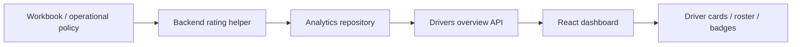

# Driver Rating Implementation and Integration

## Overview

Driver performance is evaluated with a backend-owned score that is then surfaced in the UI. The client does not calculate or rewrite the rating. It only reads the final value and renders the appropriate badge, sorting, and summary cards.

This keeps the logic:

- consistent across pages and devices
- governed by the operational rules from the workbook
- independent from browser-side tampering or stale front-end copies

---

## Why the logic lives in the backend

The driver rating is a business metric, not a presentation concern. It combines:

- persisted rating baseline
- active trip productivity
- mileage contribution
- conduct and safety penalties

Because the rating is part of fleet operations and performance review, the authoritative calculation belongs in the analytics service layer, not the browser.

The backend scoring function is implemented in:

- ../fleet-server/src/modules/analytics/driver-rating.ts

The analytics aggregation that feeds the dashboard is assembled in:

- ../fleet-server/src/modules/analytics/analytics.repository.ts

---

## Backend scoring model

The workbook is treated as the single source of truth for the rating policy. The backend converts the workbook policy into a weighted score matrix before the dashboard reads the final value.

### Sheet-to-input mapping

The scoring model is structured around the sheet logic from the workbook:

- Retainer → baseScore
- Trip-wise pay → trips + mileageKm + tonnes
- Incentives → incentiveBonus
- Scoring and safety → fuelTheftCases + overspeedingCases
- Lunch allowance → excluded unless the workbook explicitly includes it in the rating logic
- Pay summary → validation layer only
- Company cost → operational context only, not a direct rating input

### Score matrix

The rating is based on a weighted 100-point score:

- Retainer / base score: 50
- Productivity: 30
- Incentives: 10
- Safety: 20

This yields a strict structure:

```ts
const DRIVER_RATING_CONFIG = {
  retainerWeight: 50,
  productivityWeight: 30,
  incentivesWeight: 10,
  safetyWeight: 20,

  maxTripsForProductivity: 40,
  maxMileageKmForProductivity: 2500,
  maxTonnesForProductivity: 100,

  theftPenaltyPerCase: 6,
  overspeedPenaltyPerCase: 3,

  inactivityWindowDays: 30,
  inactiveScore: 0,
  inactiveRating: 0,

  excellentMin: 85,
  veryGoodMin: 75,
  goodMin: 65,
  fairMin: 55,
  weakMin: 45,
  poorMin: 35,
}
```

### Formula

```ts
const retainerComponent = (baseScore / 5) * 50

const productivityScore = clamp(
  (trips / 40) * 12 +
    (mileageKm / 2500) * 10 +
    (tonnes / 100) * 8,
  0,
  30,
)

const incentiveScore = clamp(incentiveBonus, 0, 10)

const safetyPenalty = fuelTheftCases * 6 + overspeedingCases * 3
const safetyScore = clamp(20 - safetyPenalty, 0, 20)

const score = clamp(
  retainerComponent + productivityScore + incentiveScore + safetyScore,
  0,
  100,
)
```

### Rating bands

```ts
if (score >= 85) => rating = 5.0, band = 'Excellent'
else if (score >= 75) => rating = 4.5, band = 'Very Good'
else if (score >= 65) => rating = 4.0, band = 'Good'
else if (score >= 55) => rating = 3.5, band = 'Fair'
else if (score >= 45) => rating = 3.0, band = 'Weak'
else if (score >= 35) => rating = 2.5, band = 'Poor'
else => rating = 2.0, band = 'Poor'
```

### Inactivity rule

The system explicitly separates inactivity from poor performance. If the driver has no recent work for 30+ days, they are marked as inactive instead of receiving a generic low rating:

```ts
if (trips === 0 && mileageKm === 0 && daysSinceLastTrip >= 30) {
  return { score: 0, rating: 0, band: 'Inactive' }
}
```

This prevents a genuinely inactive driver from being treated as a poor but active performer.

---

## How a driver gets a 2.0

A driver receives a 2.0 when their score is below 35 and the driver is still active enough to avoid the inactivity guard.

### Example

```ts
baseScore = 1
trips = 1
mileageKm = 80
tonnes = 2
incentiveBonus = 0
fuelTheftCases = 1
overspeedingCases = 0
```

Step by step:

```ts
retainerComponent = (1 / 5) * 50 = 10
productivityScore = (1 / 40) * 12 + (80 / 2500) * 10 + (2 / 100) * 8
                  = 0.30 + 0.32 + 0.16
                  = 0.78
incentiveScore = 0
safetyScore = 20 - (1 * 6 + 0 * 3) = 14

total score = 10 + 0.78 + 0 + 14 = 24.78
```

Since 24.78 < 35, the final band resolves to 2.0.

This is how a driver can still get a 2.0 even if they are not completely inactive: they simply have low productivity and low retained score, and the formula is still below the threshold.

This is why the score threshold is not a UI concern — it is a business rule encoded in the backend.

---

## Integration flow



### 1. Backend analytics build

The analytics layer aggregates driver records and computes the final rating before returning the roster to the UI.

This ensures the frontend receives a field such as:

- rating
- score
- band

already normalized and ready for display.

### 2. Driver API contract

The client-side fetch layer reads a driver overview response from the analytics endpoint.

In this app, the dashboard uses:

- src/api/drivers.js

which calls the server-side drivers overview endpoint and returns the roster and detail payload.

### 3. Frontend rendering

The UI is driven by:

- src/components/screens/DriversScreen.jsx

This screen:

- pulls the overview payload with useApiData
- stores the selected driver
- renders the roster and profile details
- colours the rating badge based on the final rating value
- sorts or prioritizes active drivers first when mileage is non-zero

The rating pill logic is defined as:

```js
const ratingTier = (r = 0) => {
  if (r === 0) return { label: "NEW", color: "#94a3b8" }
  if (r >= 4.5) return { label: "EXCELLENT", color: "#22c55e" }
  if (r >= 4) return { label: "GOOD", color: "#22c55e" }
  if (r >= 3) return { label: "FAIR", color: "#f59e0b" }
  return { label: "", color: "#94a3b8" }
}
```

A low performer does not get a visible “Needs Work” pill in the current dashboard view, which is intentional UX behavior.

---

## Active-driver prioritization

The roster intentionally brings active drivers to the top of the visible list so operators do not need to scroll through all inactive drivers to find who is working.

The dashboard logic checks active-liveness based on the driver’s mileage or similar activity signals and places those entries earlier in the list before the rest of the roster.

This is a display optimization on top of the same rating model and should be treated as a UI prioritization rule, not a replacement for the backend score.

---

## Example response shape

```json
{
  "drivers": [
    {
      "id": "drv_123",
      "fullName": "Jane Doe",
      "status": "ACTIVE",
      "mileageKm": 2600,
      "trips": 18,
      "rating": 4.8,
      "score": 92,
      "band": "Excellent"
    }
  ]
}
```

The client uses the final rating and score values exactly as received.

---

## Operational notes

- The workbook or policy should be treated as the source of truth for assumptions.
- When new scoring rules are added, the backend helper is the single place to update.
- The front-end should only respond to the final computed values.
- This architecture avoids duplicate logic and makes the dashboard safe for future auditing.

---

## Recommended maintenance rule

If a score threshold, penalty, or weighting changes, update the backend helper first and validate the calculation with a unit test before changing the UI layer.

That keeps the implementation aligned with the actual business policy and prevents drift between the server and the client.
